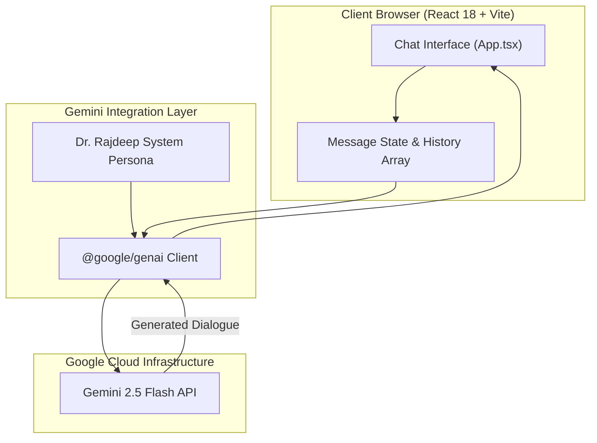

# Therapy-AI 🛋️
> **Satirical Conversational Stress-Relief Agent** powered by Google Gemini 2.5 Flash, React, and TypeScript.

<div align="center">

  [](https://therapy-ai-green.vercel.app)
  [](https://ai.google.dev/)
  [](https://react.dev/)
  [](https://www.typescriptlang.org/)

</div>

---

## 1. Overview
**Therapy-AI** is a satirical web-based stress-relief chat application featuring "Dr. Rajdeep"—an unconventional AI therapist persona that uses witty dark humor, playful roasting, and absurd misinterpretations to help users decompress. Built with React, TypeScript, and the **Google GenAI SDK (`@google/genai`)** leveraging `gemini-2.5-flash`, the app turns conventional therapeutic advice on its head for cathartic entertainment.

- **Live Application**: [https://therapy-ai-green.vercel.app](https://therapy-ai-green.vercel.app)
- **Primary Domain**: Conversational AI & Entertainment Systems

---

## 2. Problem
Standard mental health chatbots and therapeutic conversational tools are often overly clinical, canned, or predictable. While clinical tools serve a serious purpose, users often seek lighthearted comedic catharsis and stress relief:
1. **Clinical Monotony**: Standard conversational bots offer generic platitudes ("Take a deep breath") that fail to break negative thought spirals.
2. **Predictable Responses**: Scripted dialogue engines quickly become repetitive and artificial.

**Therapy-AI solves this** by utilizing high-temperature generative sampling and structured persona prompt instructions to generate unpredictable, humorous comedic comebacks that reframe mundane daily anxieties through satire.

---

## 3. Features

### 🎭 Satirical Persona Engine
- Specializes in tongue-in-cheek humor and deadpan comedic advice.
- High-temperature sampling (`temperature: 1.0`, `topP: 0.95`, `topK: 64`) for spontaneous dialogue.

### ⚡ Interactive Modes
- **Classic Therapy Session**: Full conversational history buffer maintaining context across dialogue turns.
- **Stateless Quip Generator**: One-off rapid quips and roasting prompts generated with zero latency overhead.

### 📱 Responsive UI & State
- Clean, responsive mobile-first chat layout with instant scroll tracking, typing indicators, and optimistic message delivery.

---

## 4. Live Demonstrations

| Feature | Surface | Live Access |
| :--- | :--- | :--- |
| **Dr. Rajdeep Session** | Humorous cathartic dialogue engine | [Start Session](https://therapy-ai-green.vercel.app) |

---

## 5. Architecture



---

## 6. Tech Stack

| Component | Technology | Role |
| :--- | :--- | :--- |
| **Model** | Google Gemini 2.5 Flash | High-speed generative text model |
| **SDK** | `@google/genai` (1.29.1) | Direct API client for Google Generative AI |
| **Frontend** | React 18.2, TypeScript 5.2 | Component architecture and state |
| **Build & Dev** | Vite 5.0 | ES module bundler and dev server |
| **Hosting** | Vercel | Production CDN deployment |

---

## 7. Installation & Local Setup

### Prerequisites
- **Node.js**: v18.0.0 or higher
- **Gemini API Key**: From [Google AI Studio](https://aistudio.google.com/)

### Instructions

1. **Clone the repository**:
   ```bash
   git clone https://github.com/rajdeepbhattacharyya25-pixel/therapy-AI-.git
   cd therapy-AI-
   ```

2. **Install dependencies**:
   ```bash
   npm install
   ```

3. **Configure Environment Variables**:
   Create a `.env.local` file:
   ```bash
   API_KEY=your_gemini_api_key_here
   ```

4. **Start local development server**:
   ```bash
   npm run dev
   ```

---

## 8. Testing & Validation

### Verification Points
- ✅ **API Key Guard**: Prevents runtime crashes with descriptive configuration alerts if `API_KEY` is undefined.
- ✅ **Chat History Continuity**: Confirms multi-turn context persistence during conversational exchanges.
- ✅ **Temperature Stability**: Verified token stream coherence at high temperature without hallucinating corrupted syntax.

---

## 9. Roadmap
- [ ] **Voice Synthesis**: Adding comedic speech synthesis via Web Audio / ElevenLabs integration.
- [ ] **Prescription Generator**: Shareable visual satirical "Doctor's Prescription" cards for social media.
- [ ] **Sound Effects**: Comic sound cues for message delivery and punches.

---

## 10. Credits & Acknowledgements
- [Google AI Studio](https://aistudio.google.com/) for the Gemini 2.5 Flash engine.
- Designed and built by [Rajdeep Bhattacharyya](https://github.com/rajdeepbhattacharyya25-pixel).
